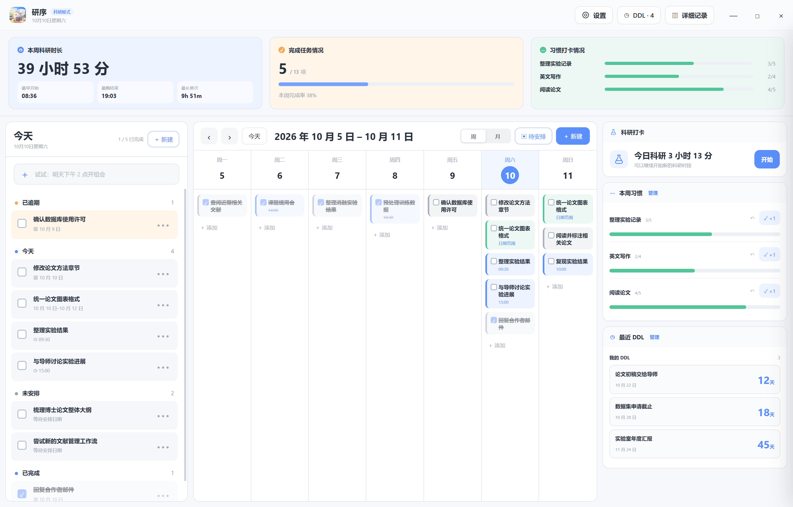
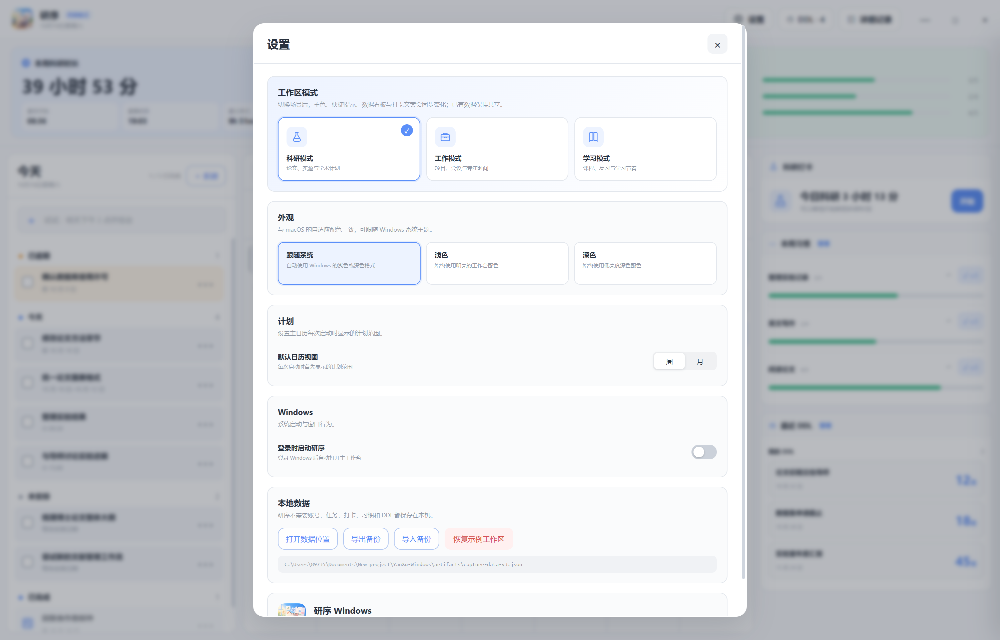
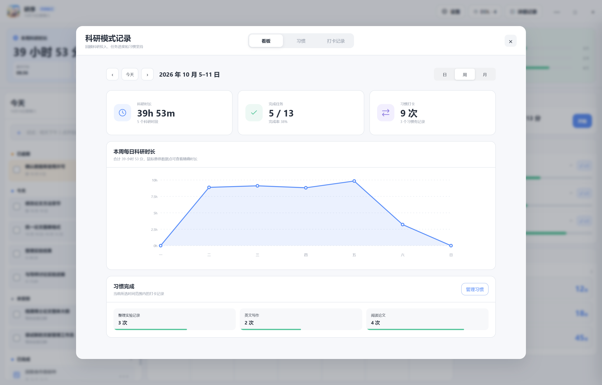

# 研序 Windows

<p align="center">
  
</p>

<p align="center">
  <strong>把任务、日历、投入时间、习惯与截止日期放进一个本地优先的 Windows 工作台。</strong>
</p>

<p align="center">
  
  
  
  
  <a href="LICENSE"></a>
</p>

研序 Windows 是 [roseLuos/YanXu](https://github.com/roseLuos/YanXu) 的 Windows 适配版。项目延续原作的工作台布局和本地优先理念，并针对 Windows 重写了桌面外壳、设置中心、数据看板与交互。

本仓库保留上游 macOS 源码作为来源记录；Windows 应用由 `src/`、`tests/` 和根目录的 npm 配置构建。详细来源及授权说明见 [NOTICE.md](NOTICE.md)。



## 功能

- 今天、逾期、待安排和已完成任务，已完成任务统一置底；
- 周视图与月视图、拖放排期、日期范围、固定时间和重复任务；
- 中文自然语言快速输入；
- 科研、工作、学习三种模式，分别提供独立配色、图标、提示和看板文案；
- 与 macOS 灵动岛展开态一致的桌面卡片，可快速新增任务、完成任务、切换外观并锁定位置；
- 专注时段开始/结束打卡、记录编辑与历史管理；
- 日/周/月数据看板、投入时长趋势、任务完成率和习惯统计；
- 习惯目标、多次打卡、撤销与管理；
- 个人 DDL 与正向里程碑；
- 浅色、深色与跟随系统主题；
- 登录时启动、本地数据、JSON 备份导入导出与示例工作区；
- 免安装便携版和 NSIS 安装包。

Windows 版使用固定在桌面的计划卡片替代 macOS 顶部灵动岛，不包含 Apple 日历同步、日程提醒及 CCFDDL 数据。

## 界面

| 设置中心 | 数据看板 |
| --- | --- |
|  |  |

## 从源码运行

### 环境要求

- Windows 10 或 Windows 11（x64）；
- Node.js 22 或更高版本；
- npm 10 或更高版本。

```powershell
git clone https://github.com/roseLuos/YanXu_Win.git
cd YanXu_Win
npm ci
npm start
```

首次启动会自动生成一组不包含真实个人信息的示例数据。数据只初始化一次，不会覆盖已有内容。

## 检查与构建

```powershell
# 语法检查和自动测试
npm run check

# 生成免安装便携版
npm run dist:portable

# 同时生成安装版和便携版
npm run dist
```

构建产物位于 `dist-windows/`，该目录不会提交到 Git。

## 数据与隐私

正式版数据默认保存在：

```text
%APPDATA%\yanxu-windows\data.json
```

- 不需要账号，不连接研序服务器，也不包含遥测或第三方分析 SDK；
- 任务、习惯、DDL、设置与打卡记录仅保存在本机；
- 三种工作区模式共享同一份数据，切换模式不会删除或复制任务；
- 可在设置中导出 JSON 备份，建议升级或迁移设备前先备份。

请勿在 Issue、日志、截图或 Pull Request 中提交真实个人数据。

## 项目结构

```text
.
├── src/
│   ├── main.js                 # Electron 主进程、持久化和系统集成
│   ├── preload.js              # 安全的渲染进程桥接层
│   ├── renderer/               # Windows 工作台、桌面卡片界面与交互
│   └── shared/                 # 快速解析与工作区模式配置
├── tests/                      # Node.js 自动测试
├── Resources/                  # 应用图标及上游资源
├── docs/
│   ├── USER_GUIDE.md          # Windows 使用指南
│   ├── ARCHITECTURE.md        # 进程边界、数据与安全设计
│   ├── BUILDING.md            # Windows 开发、构建与发布
│   └── images/                # 公开界面截图
├── Sources/                    # 上游 macOS 源码（不进入 Windows 构建）
└── package.json                # Windows 开发、测试和打包命令
```

Electron 使用 `contextIsolation` 与沙箱，渲染进程不启用 Node.js；构建包只包含 `src/`、应用图标与许可证。

## 作者与贡献者

研序及其 Windows 适配版由 [@roseLuos](https://github.com/roseLuos) 独立开发和维护。项目提交、npm 元数据与发行版权信息统一使用 `roseLuos` 身份。

## 参与贡献

欢迎提交 Issue 和 Pull Request。开始前请阅读 [CONTRIBUTING.md](CONTRIBUTING.md)，实现细节见 [架构说明](docs/ARCHITECTURE.md)，构建发布见 [Windows 构建指南](docs/BUILDING.md)，安全问题请查看 [SECURITY.md](SECURITY.md)。

## 上游与许可证

本项目基于 [roseLuos/YanXu](https://github.com/roseLuos/YanXu) 的 MIT 许可源码适配。原版权声明与 MIT License 保留在 [LICENSE](LICENSE) 中，额外说明见 [NOTICE.md](NOTICE.md)。
